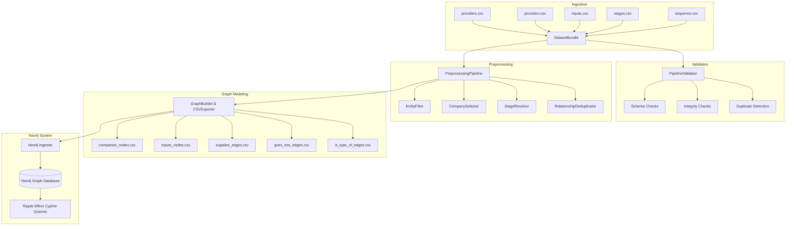

# AtmoGraph Architecture & System Design

## 1. Overview
AtmoGraph models the multi-tier supply chain of the global semiconductor industry as a directed property graph. It identifies single points of failure, supply bottlenecks, and upstream disruption propagation (ripple effect) across companies, tools, materials, and production stages.

## 2. Graph Schema Model

### Nodes:
- `(:Company {id, name, country, connected_inputs})`
- `(:Input {id, name, type, stage_name})`
- `(:Stage {id, name, description})`

### Relationships:
- `(:Company)-[:SUPPLIES {share_provided, year, source}]->(:Input)`
- `(:Input)-[:GOES_INTO]->(:Input)`
- `(:Input)-[:IS_TYPE_OF]->(:Input)`
- `(:Input)-[:BELONGS_TO]->(:Stage)`

## 3. Data Flow Metrics
- **Raw Ingestion:** 5 relational tables totaling ~1,900 rows.
- **Top Supplier Extraction:** Top 20 organizations ranked by unique input connectivity.
- **Hierarchical Propagation:** Multi-tier stage assignment resolving missing stages for tool and material resources.

---

## 4. Architectural Design Decisions & Engineering Specifications

- **ADR-01: Graph Traversal Latency Bounds** — Restricts multi-hop ripple propagation traversals to sub-50ms execution times across 5-tier supplier trees.
- **ADR-02: Idempotent Schema Migrations** — Mandates IF NOT EXISTS clauses for all Cypher constraints and property indexes to prevent deployment drift.
- **ADR-03: Directed Acyclic Graph Invariant** — Enforces topological cycle detection on GOES_INTO relationship chains during intermediate stage validation.
